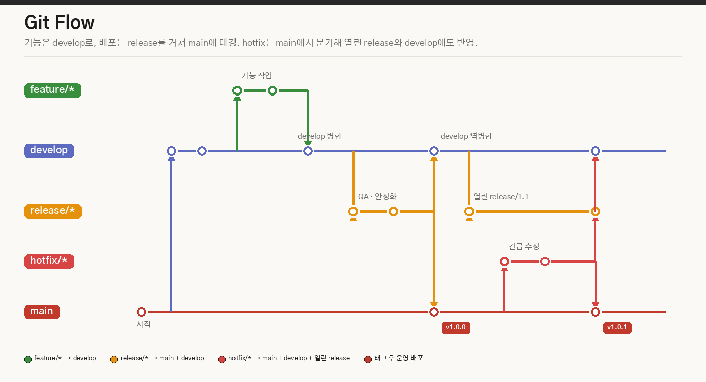
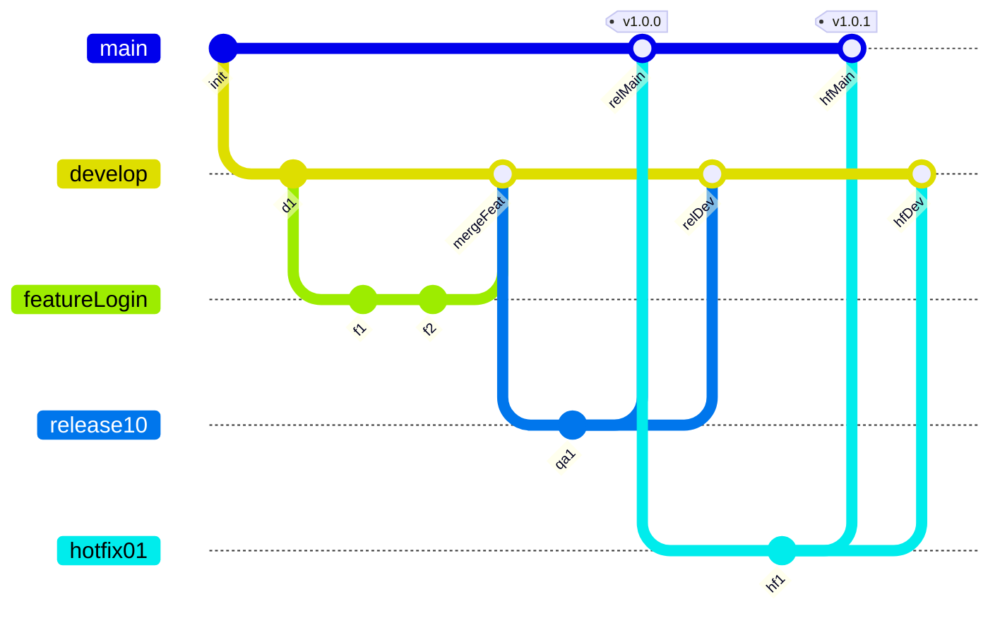
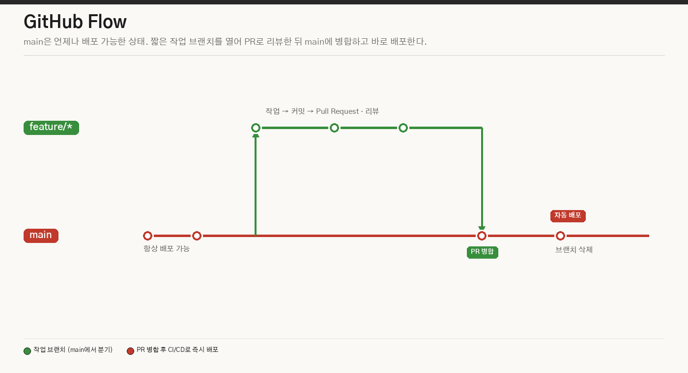
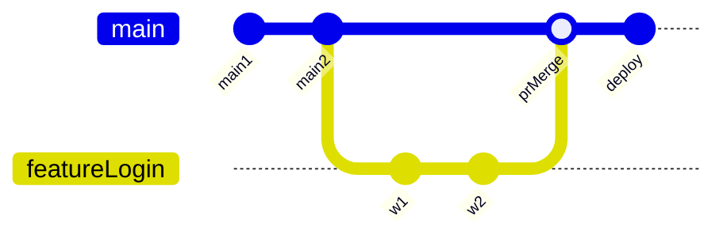
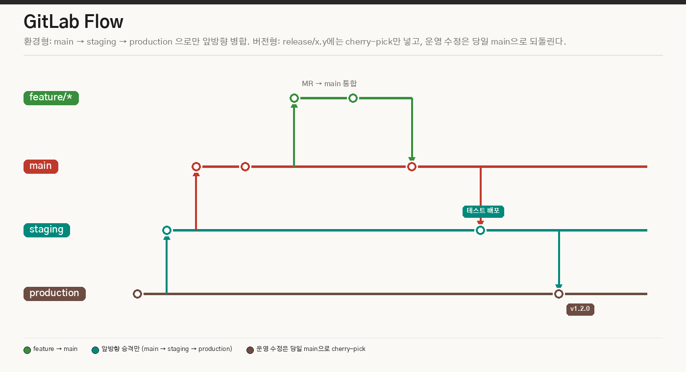
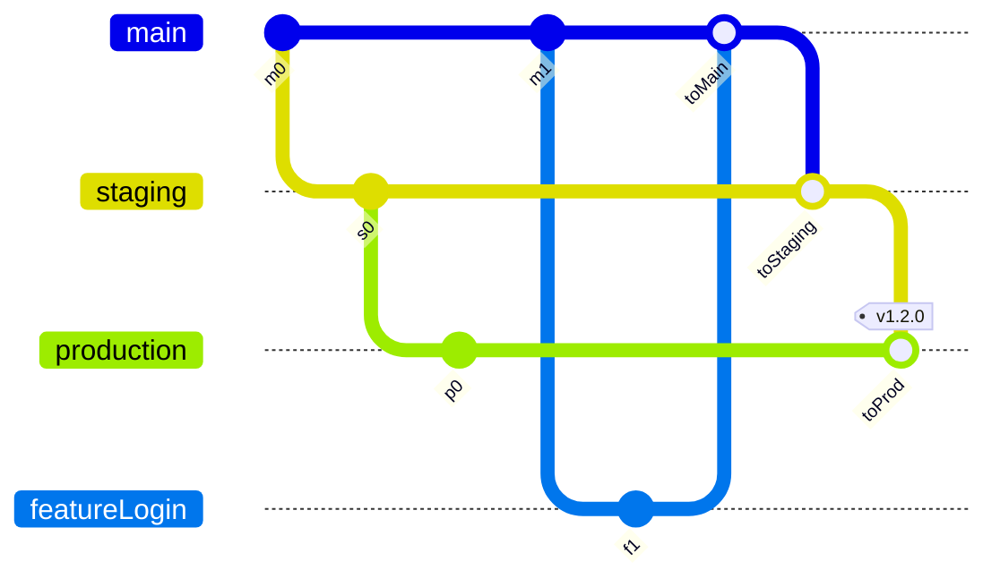
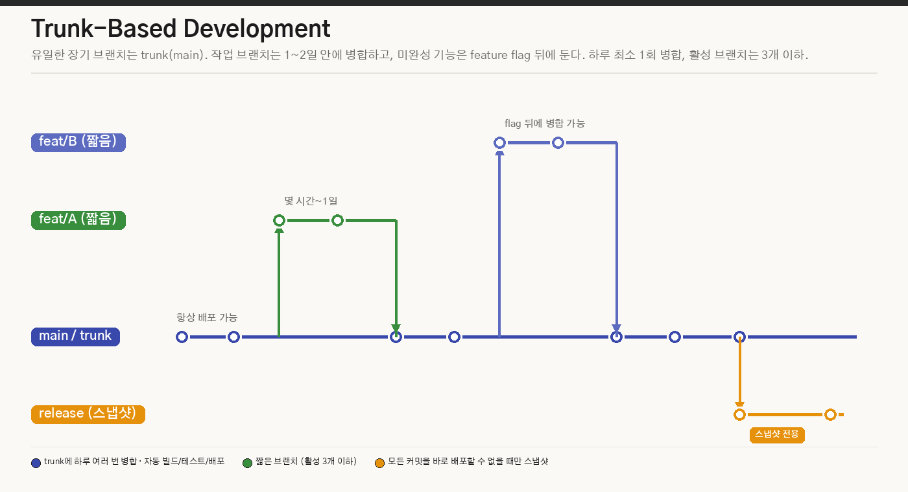
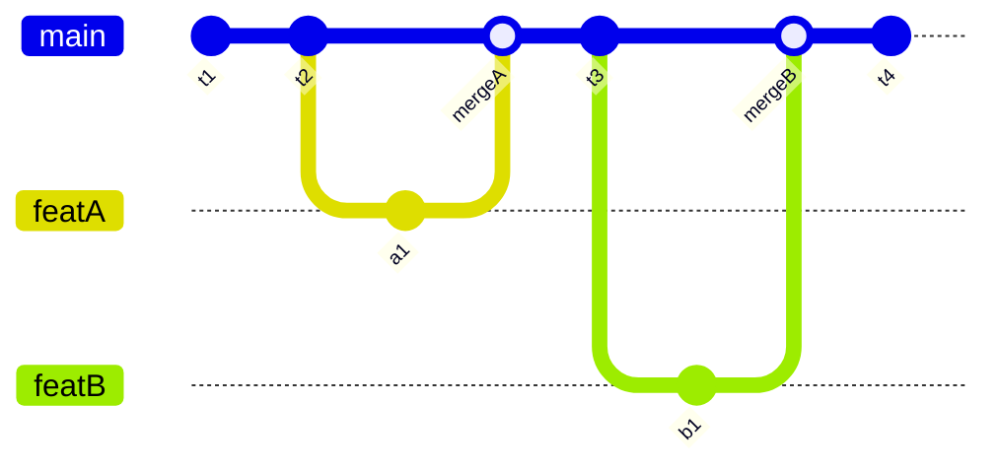

# Git 브랜치 전략 (형상관리)

브랜치는 코드 분기만이 아니라, 개발·테스트·배포 흐름을 팀에 맞게 정리하는 도구다. 어떤 전략이 더 우월한지가 아니라, 이 팀의 배포 주기와 QA·승인 방식에 무엇이 맞는지를 고른다.

자세한 명령 예시는 [references/git-commands.md](references/git-commands.md), 팀 규칙 템플릿과 문서 작성 순서는 [references/team-rules.md](references/team-rules.md)를 본다.

## 작업 순서

1. 아래를 물어 팀 상황을 파악한다. 이미 말한 항목은 다시 묻지 않는다.
   - 팀 규모와 원격 저장소(GitHub, GitLab 등)
   - 배포 주기(수시 / 주간 / 고정 릴리스)
   - 환경(개발, 스테이징, 운영)과 QA 일정·코드 프리즈 여부
   - 운영 반영 승인 절차 유무
   - CI/CD와 테스트 자동화 수준
   - 핫픽스 빈도와, 동시에 지원해야 하는 버전 수
   - 선호하는 리뷰어 수·병합 방식·버전 규칙
2. 이 스킬의 비교 표와 선택 가이드로 전략을 하나 추천하고, 맞지 않는 이유도 짧게 밝힌다.
3. 사용자가 확인하면 [references/team-rules.md](references/team-rules.md) 템플릿을 채워 `BRANCHING.md` 또는 `CONTRIBUTING.md` 초안을 만든다. 배포 주기가 바뀌면 문서도 함께 고친다.

## 1. Git Flow

정형화된 브랜치로 릴리스 주기를 안정적으로 관리한다. Vincent Driessen이 제안한 모델이다.

**목적:** 기능 개발, 릴리스 준비, 운영 배포, 긴급 수정을 역할이 다른 브랜치로 나눠 장기 프로젝트와 안정성 중심 개발을 돕는다.

| 브랜치 | 역할 | 분기 출처 | 병합 대상 |
| --- | --- | --- | --- |
| `main` | 운영에 나가는 최종 코드 | — | 태그 후 배포 |
| `develop` | 다음 릴리스를 모으는 통합 개발 브랜치 | `main`(초기) | `release/*` |
| `feature/*` | 기능 단위 작업 | `develop` | `develop` |
| `release/*` | 배포 준비와 QA. 안정화만 하고 기능은 넣지 않는다 | `develop` | `main`과 `develop`(역병합) |
| `hotfix/*` | 운영 중 긴급 수정 | `main` | `main`, `develop`, 열려 있는 `release/*` |

**병합·배포 흐름**

1. `develop`에서 `feature/*`를 분기한다.
2. 기능이 끝나면 `develop`으로 병합한다.
3. 배포 시점이 되면 `release/*`를 분기하고 QA 수정은 이 브랜치에서만 한다.
4. 테스트가 끝나면 `main`에 병합하고 태그(`vX.Y.Z`)를 붙인 뒤, 같은 내용을 `develop`에도 역병합한다.
5. `main`에서 운영 배포를 한다.
6. 긴급 이슈는 `hotfix/*`를 `main`에서 분기한다. `main`에 병합·태깅한 뒤, `develop`과 열려 있는 `release/*`에도 반영한다. 어느 한쪽에만 넣으면 다음 릴리스에서 같은 버그가 되살아난다.

**맞는 팀:** 릴리스 주기가 뚜렷하고 QA가 후보 버전을 한동안 고정하는 조직. CI는 보통 `develop` 또는 `release/*`에서 테스트하고 `main`에서 배포한다.

**주의점:** 브랜치가 많아 규율을 지키지 않으면 흐름이 무거워진다. 하루에도 여러 번 운영 배포하는 팀에는 맞지 않다. `release/*`에 새 기능을 넣지 않는다.

## 2. GitHub Flow

PR 중심의 짧은 협업 구조로, 빠른 피드백과 자동 배포에 유리하다.

**목적:** 항상 배포 가능한 하나의 `main`을 중심으로, 작업 브랜치와 Pull Request만으로 히스토리를 단순하게 유지한다.

| 브랜치 | 역할 | 분기 출처 | 병합 대상 |
| --- | --- | --- | --- |
| `main` | 언제나 배포 가능한 최신 코드 | — | 병합 후 자동 배포 |
| `feature/*` 또는 `<이슈번호>-<작업>` | 기능·수정·핫픽스를 포함한 작업 단위 | `main` | `main` (PR) |

**병합·배포 흐름**

1. `main`에서 작업 브랜치를 만든다.
2. 기능을 개발하고 커밋한다.
3. Pull Request를 열고 리뷰와 CI를 통과시킨다.
4. 승인과 함께 `main`에 병합한다. 병합 방식은 Merge commit, Squash & Merge, Rebase & Merge 가운데 팀이 하나를 정한다.
5. 병합 후 `main`을 자동 배포하고, 작업 브랜치는 삭제한다. 핫픽스도 같은 경로를 쓴다.

**맞는 팀:** 작은 팀, 또는 병합만 되면 바로 배포할 수 있는 자동 배포 환경. 프론트엔드·스타트업에서 자주 쓴다.

**주의점:** QA 프리즈가 필요하거나, 이미 나간 버전을 여러 개 동시에 지원해야 하면 이 모델만으로는 부족하다. `main`이 항상 배포 가능해야 하므로, 깨진 빌드를 올리지 않는다.

## 3. GitLab Flow

단순한 메인라인에, 테스트·운영 환경을 나누는 승격 개념을 더한 전략이다. 두 가지 형태가 있다.

**목적:** `main`에서 통합하고, 환경 브랜치 또는 버전 브랜치로 배포 단계를 드러낸다. GitLab CI/CD의 브랜치·태그 Job과 이슈 트래커(Jira 등)와 잘 맞는다.

| 브랜치 | 역할 | 분기 출처 | 병합 대상 |
| --- | --- | --- | --- |
| `main` | 통합 메인라인 | — | 환경 브랜치로 앞방향 승격, 또는 배포 트리거 |
| `staging` / `preprod` | 사전 테스트·검수 환경 | `main`(승격) | `production` (앞방향만) |
| `production` | 운영 배포 브랜치 | `staging` 또는 `main`(승격) | 태그 후 운영 배포 |
| `feature/*`, `bugfix/*`, `issue-*` | 작업 단위 | `main` | `main` (MR/PR) |
| `release/x.y` (버전형) | 이미 나간 버전 라인. 새 기능은 넣지 않는다 | 해당 버전 스냅샷 | cherry-pick만 수신 |

**병합·배포 흐름**

1. `main`에서 작업 브랜치를 만들고, 끝나면 Merge/Pull Request로 `main`에 병합한다.
2. **환경형:** `main` → `staging`(또는 pre-production) → `production` 순서로만 앞방향 병합한다. 환경 브랜치를 며칠씩 방치하면 서로 갈라지므로, 업스트림에서 자주 갱신한다.
3. 브랜치 이름 또는 태그(`v1.2.0` 등)를 기준으로 CI/CD Job을 나눈다. 예: `staging`은 테스트 환경 배포, `production` 또는 태그는 운영 배포.
4. **버전형:** 지원 중인 버전마다 `release/x.y`를 둔다. 이 브랜치에는 cherry-pick만 넣고 기능을 추가하지 않는다. 운영에서 고친 내용은 같은 날 `main`으로도 cherry-pick한다. 늦게 되돌리면 다음 버전에서 버그가 되살아난다.

**맞는 팀:** 테스트·운영 환경이 분명히 나뉘거나, 이미 나간 버전을 소수 지원해야 하는 SaaS·운영 팀.

**주의점:** 환경 브랜치가 서로 다른 방향으로 커지면 Git Flow보다 더 혼란스럽다. 승격이나 버전 관리가 전혀 없으면 이 구조를 둘 이유가 없다.

## 4. Trunk-Based Development

하나의 메인 브랜치에 자주 병합하고, 자동화된 테스트와 배포로 지속 통합을 유지한다.

**목적:** 장기 브랜치는 `main`(또는 `trunk`) 하나뿐이고, 항상 배포 가능한 상태를 지킨다. 작은 단위로 빠르게 합치는 것이 핵심이다.

| 브랜치 | 역할 | 분기 출처 | 병합 대상 |
| --- | --- | --- | --- |
| `main` / `trunk` | 유일한 장기 브랜치이자 배포 원천 | — | 병합 시 자동 빌드·테스트·배포 |
| `feature/*` (선택, 수명 짧음) | 1~2일 안에 끝나는 작업 | `main` | `main` |
| `release/*` (선택) | 모든 커밋을 바로 배포할 수 없을 때만 쓰는 스냅샷 | `main` | 수정은 trunk로 즉시 cherry-pick |

**병합·배포 흐름**

1. `main`에서 직접 작업하거나, 수명이 짧은 작업 브랜치를 연다.
2. 끝나자마자 `main`에 병합한다. 하루 최소 1회는 병합하고, 하루에도 여러 번 합쳐도 된다. 활성 작업 브랜치는 3개 이하로 유지한다.
3. 아직 끝나지 않은 기능은 feature flag 또는 dark release 뒤에 두고 trunk에 넣는다. 긴 브랜치로 숨기지 않는다.
4. 병합이면 자동 빌드·테스트·배포를 탄다. 병합 방식은 보통 `merge --no-ff` 또는 squash다.
5. 릴리스 브랜치를 쓴다면 스냅샷 용도만 허용한다. 그 라인에서 고친 내용은 즉시 trunk로 cherry-pick한다.

**맞는 팀:** 테스트 자동화와 CI/CD가 갖춰진 DevOps·MSA 조직. 배포가 잦고 피드백을 빨리 받아야 하는 팀.

**주의점:** 테스트가 느리거나 없고, 리뷰가 여러 날 걸리거나, 작업을 하루에 한 번도 합칠 수 없으면 trunk-based라고 부르지 않는다. 코드 프리즈와 대규모 통합 단계를 전제로 하지 않는다.

## 비교

| 전략 | 핵심 목적 | 병합 방식 | 배포 연동 | 추천 조직 | 쓰지 말아야 할 때 |
| --- | --- | --- | --- | --- | --- |
| Git Flow | 정형화된 릴리스 | feature → develop → release → main, 핫픽스는 main·develop·열린 release | 태그 기반 배포. 테스트는 develop/release, 배포는 main | 릴리스·QA 중심 프로젝트 | 하루에 여러 번 운영 배포하는 팀 |
| GitHub Flow | 민첩한 피드백 | 작업 브랜치 → PR → main | PR 병합 시 `main` 자동 배포 | 스타트업, 자동 배포가 되는 작은 팀 | QA 프리즈가 있거나, 이미 나간 버전을 여러 개 지원해야 할 때 |
| GitLab Flow | 환경·버전 분리 | 앞방향 승격, 버전형은 cherry-pick만 | 환경별 CI/CD Job, 태그로 배포 트리거 | 테스트/운영 환경이 있는 팀, 소수 버전을 지원하는 SaaS | 환경 브랜치가 며칠씩 갈라지거나, 승격·버전 관리가 전혀 없을 때 |
| Trunk-Based | 작은 단위의 빠른 배포 | 짧은 브랜치를 trunk에 자주 병합 (`merge --no-ff` 또는 squash) | `main` 병합 시 즉시 배포 | DevOps 조직, MSA 팀 | 테스트가 약하고, 리뷰가 여러 날 걸리거나, 하루에 한 번도 병합할 수 없을 때 |

## 선택 가이드

아래 순서대로 고른다.

1. **정형 릴리스와 QA 후보 고정(프리즈)이 있는가?** 있으면 Git Flow를 먼저 본다.
2. **테스트 환경과 운영 환경을 브랜치로 구분해 승격해야 하는가, 또는 이미 나간 버전을 소수 지원해야 하는가?** 있으면 GitLab Flow(환경형 또는 버전형)가 맞다.
3. **`main`만 두고 병합 즉시 배포해도 되는가? 피드백을 단순하고 빠르게 받고 싶은가?** GitHub Flow.
4. **자동화된 테스트와 배포가 있고, 하루에도 여러 번 작은 단위로 합칠 수 있는가?** Trunk-Based Development.

금융권처럼 운영 반영에 승인·QA 단계가 있는 조직(예: BNK와 비슷한 흐름)에서는 보통 Git Flow나 GitLab Flow가 잘 맞다. 릴리스와 핫픽스, 또는 환경 승격 경로가 승인 절차와 맞물리기 때문이다. 반대로 배포가 이미 완전 자동이고 QA 프리즈가 없다면 무리해서 Git Flow를 쓸 필요는 없다.

릴리스가 달력으로 정해져 있고 작업이 여러 갈래로 병렬이며 QA가 배포를 게이트한다면, GitHub Flow만으로는 부족해 Git Flow나 GitLab Flow 쪽으로 옮기는 편이 낫다.

## 흔한 실수

- **Git Flow인데 매 병합마다 배포한다.** 장기 브랜치(`develop`, `release/*`)를 둘 이유가 없다. GitHub Flow나 Trunk-Based를 검토한다.
- **1주짜리 브랜치를 trunk-based라고 부른다.** trunk-based는 하루에 한 번은 trunk로 합치고, 그 trunk가 항상 녹색이어야 한다.
- **`release/*`에 기능을 추가한다.** 릴리스 브랜치는 안정화 전용이다. 기능은 `develop` 또는 trunk에서 다음 주기에 넣는다.
- **hotfix가 `develop`이나 trunk에 들어가지 않는다.** 다음 릴리스가 운영 수정을 덮어 버그를 되돌린다. Git Flow라면 열린 `release/*`에도 넣는다.
- **환경 브랜치를 방치해 서로 갈라진다.** 업스트림에서 앞방향으로만 자주 갱신한다. 운영 수정은 당일 `main`으로 cherry-pick한다.
- **코드 프리즈와 대규모 통합을 전제로 한다.** Trunk-based 팀은 둘 다 피하고, 미완성 작업은 flag 뒤에 두고 매일 합친다.

## 팀 규칙에 반드시 적을 항목

`CONTRIBUTING.md` 또는 `BRANCHING.md`에는 적어도 아래를 명시한다. 빈 칸을 채우는 템플릿은 [references/team-rules.md](references/team-rules.md)에 있다.

- 배포 브랜치
- 작업 시작 브랜치
- 최대 브랜치 수명
- QA 수정이 들어가는 위치
- hotfix를 추가로 반영하는 위치
- 병합 권한자
- 병합 후 브랜치 삭제 여부
- 브랜치 이름, 커밋 메시지, PR/MR 규칙, 보호 브랜치, 태그/버전 규칙

## 참고 문서

- [우아한형제들 기술블로그, 우린 Git-flow를 사용하고 있어요](https://techblog.woowahan.com/2553/)
- [Atlassian, Trunk-based development](https://www.atlassian.com/continuous-delivery/continuous-integration/trunk-based-development)
- [DORA, Trunk-based development](https://dora.dev/capabilities/trunk-based-development/)
- [Git 브랜치 전략 정리 (weaklion1)](https://weaklion1.tistory.com/35)
- [형상관리 브랜치 전략 정리 (정리 출처)](https://okbear3.tistory.com/73)
